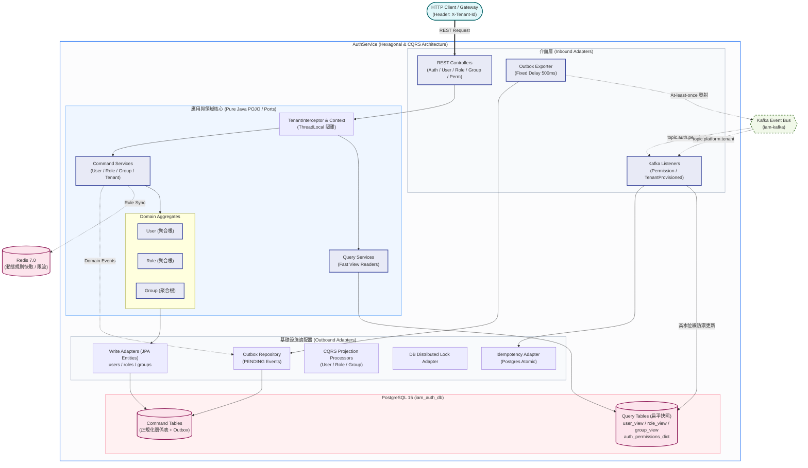

# AuthService (身分驗證與權限視圖微服務)

> **定位**：企業級 IAM 平台之身分認證、RBAC 權限管理、多租戶安全防線，以及 CQRS 讀取端投影器（Query Side Projection View）。

---

## 目錄 (Table of Contents)
- [核心定位與職責](#核心定位與職責)
- [核心技術生態 (Tech Stack)](#核心技術生態-tech-stack)
- [系統架構拓撲 (Architecture Blueprint)](#系統架構拓撲-architecture-blueprint)
- [關鍵設計美感與架構亮點](#關鍵設計美感與架構亮點)
  - [1. 嚴格整潔架構 (Strict Clean / Hexagonal Architecture)](#1-嚴格整潔架構-strict-clean--hexagonal-architecture)
  - [2. 戰術領域驅動設計 (Tactical DDD 充血模型)](#2-戰術領域驅動設計-tactical-ddd-充血模型)
  - [3. 極致 CQRS 讀寫分離與扁平視圖 (Flat Projections)](#3-極致-cqrs-讀寫分離與扁平視圖-flat-projections)
  - [4. CQRS 充血非同步投影與高水位線版本防禦 (High-Water Mark)](#4-cqrs-充血非同步投影與高水位線版本防禦-high-water-mark)
  - [5. 事件驅動 (EDA) 與租戶開通 Exactly-Once 語意](#5-事件驅動-eda-與租戶開通-exactly-once-語意)
  - [6. 發件箱模式 (Outbox Pattern) 與分散式安全](#6-發件箱模式-outbox-pattern-與分散式安全)
  - [7. 多租戶隱式隔離與執行緒安全防禦](#7-多租戶隱式隔離與執行緒安全防禦)
  - [8. 雙軌聯防動態授權機制 (Dual-Track Authz)](#8-雙軌聯防動態授權機制-dual-track-authz)
- [模組目錄結構 (Hexagonal View)](#模組目錄結構-hexagonal-view)
- [RESTful API 規格清單](#restful-api-規格清單)
- [事件總線合約 (Event Bus Topics & Contracts)](#事件總線合約-event-bus-topics--contracts)
- [環境準備與啟動指南 (Getting Started)](#環境準備與啟動指南-getting-started)

---

## 核心定位與職責

`AuthService` 在整體 IAM 微服務生態體系中扮演著**「身分與權限的看門人」**與**「高速讀取查詢中樞」**：

1. **認證與令牌簽發 (Identity & JWT Issuance)**：提供安全登入驗證，結合 BCrypt 雜湊演算法與強型態 JWT 簽發，將使用者持有的角色與權限字串編織入 Token 載荷。
2. **多租戶生命週期管理 (Multi-Tenant RBAC & Groups)**：管理使用者（User）、角色（Role）、群組（Group）之聚合根狀態與多對多關聯綁定，全量業務均強制綁定於租戶隔離空間（`tenant_id`）。
3. **CQRS 讀取端投影中心 (Query Side Projection View)**：作為微服務生態中的讀取端視圖，異步監聽下游（如 `DeptTreeService`）發布的領域事件，動態更新去正規化快照表，提供 $O(1)$ 的極速權限檢索。
4. **全域安全底座串接 (Shared Kernel Integration)**：整合自研 `shared-kernel` 安全基礎設施，落實基於 Redis Cache-Aside 引擎之動態 URL AntPath 鑑權與 `@RequiresPermission` 雙軌安全攔截。

---

## 核心技術生態 (Tech Stack)

* **核心框架**：Java 21, Spring Boot 4.0.6
* **資料持久化**：Spring Data JPA, Hibernate, PostgreSQL 15 (`iam_auth_db`)
* **消息中介**：Apache Kafka 3.6 (KRaft 模式) & Spring Kafka
* **快取與安全**：Redis 7.0 (Lettuce 連線池), Redisson
* **身分驗證**：Auth0 `java-jwt 4.5.2`, Spring Security Crypto (BCrypt)
* **資料庫防護**：PostgreSQL 行級排他鎖 (`INSERT ... ON CONFLICT`)、樂觀鎖 (`@Version`)
* **工具庫**：Lombok, Jackson JSR-310, Apache Commons Lang3, `shared-kernel 1.0.0-SNAPSHOT`

---

## 系統架構拓撲 (Architecture Blueprint)



---

## 關鍵設計美感與架構亮點

### 1. 嚴格整潔架構 (Strict Clean / Hexagonal Architecture)
* **領域層 100% 潔癖度 (Zero-Dependency POJO)**：
  * `com.example.demo.application.domain` 核心完全為原生 Java 撰寫，無任何 Spring、JPA、Hibernate、Lombok 等框架依賴。
  * 聚合根（`User`、`Role`、`Group`）完全主導業務不變量，不向框架妥協。
* **依賴反轉原則 (DIP)**：
  * Application 層透過 `com.example.demo.application.port` 定義所需之驅動埠（Inbound Port）與被動埠（Outbound Port），由 `infra/adapter` 實作具體的技術橋接，技術細節（DB、Kafka、Redis）永遠處於六角架構外圈。

### 2. 戰術領域驅動設計 (Tactical DDD 充血模型)
* **嚴格防禦性編程**：
  * 徹底拔除傳統實體所有的公共 Setter，消滅「貧血模型（Anemic Model）」。
  * 透過專屬業務語意方法（如 `user.assignRole(roleId)`、`user.changePassword(...)`、`role.addPermission(...)`）變更狀態。
  * 強制實施強型態值物件（Value Objects）：`UserId`、`RoleId`、`GroupId`、`AccountInfo`、`UserStatus`，防止 Primitive Obsession（基元型別偏執）。
* **雙軌制角色設計 (Dual-Track Role Binding)**：
  * **對內物理儲存**：聚合根內部持有強型態的 `Set<RoleId>` (UUID)，於關聯表保持最高檢索效率。
  * **對外事件投影**：於 CQRS 視圖與領域事件（`UserChangedEvent`）發布時，由應用層自動轉譯為具備強業務語意的代碼集合（`roleCodes`，如 `ADMIN`、`SALES`）。

### 3. 極致 CQRS 讀寫分離與扁平視圖 (Flat Projections)
傳統關聯式架構在列表查詢時常面臨嚴重的一對多 `N+1` 查詢災難。本服務透過 CQRS 讀寫模型絕對物理隔離：

* **寫入端 (Command Side)**：
  * 專注於規範化關聯維護（`users`, `roles`, `groups`, `user_roles`, `group_members`, `group_roles`），以 Local Transaction 保證強一致性。
* **讀取端 (Query Side - 扁平快照)**：
  * 讀取查詢直接透過 `QueryService` 直擊專屬去正規化（Denormalized）快照表，完全繞過聚合根與關聯大 JOIN：
    * `user_view`：將使用者擁有的多個角色直接摺疊壓縮為 **CSV 欄位 (`roles_csv`，如 "ADMIN,AUDITOR")**。
    * `role_view`：將角色所屬的大量權限點直接序列化為 **大 JSON 欄位 (`permissions_json`)**，以單筆複合唯一索引（`tenant_id, role_code`）極速取回。
    * `group_view`：扁平化包含 `members_json` 與 `roles_json`。
    * `auth_permissions_dict`：全域權限字典快照視圖。

### 4. CQRS 充血非同步投影與高水位線版本防禦 (High-Water Mark)
* 權限字典的讀取視圖端（`PermissionEventHandler`）異步監聽來自 `DeptTreeService` 的 `topic.auth.permission` 事件。
* **淘汰傳統中介 UseCase**：由介面層的 Event Listener 直接驅動充血投影實體 `PermissionDictView`。
* **邏輯時鐘與高水位線版本防禦 (Logical Version Defense)**：
  * 接收之領域事件自帶 Aggregate `version` 水位線。
  * 投影實體內部以 `existing.syncDetails(..., eventVersion)` 自行比對版本號：若傳入事件版本小於或等於當前庫存版本，判定為亂序到達或 Kafka 重複消費，**靜默丟棄並直接忽略**，徹底免疫分散式亂序災難。

### 5. 事件驅動 (EDA) 與租戶開通 Exactly-Once 語意
* 監聽來自 `TenantService` 的開通廣播（`topic.platform.tenant`）。
* **原子去重與行級排他鎖**：
  * 透過 `IdempotencyHandlerAdapter`，利用 PostgreSQL 的唯一約束與原子寫入（`tryInsertEvent`），取得事件首次執行權。
* **事務同生共死**：
  * 冪等防護紀錄與初始化租戶 Root Admin 的業務邏輯包裹在同一個 `@Transactional` 中。若業務失敗，去重記錄同步 Rollback，確保 Kafka 再次重試時能順利放行，達到真正的 Exactly-Once 交付語意。

### 6. 發件箱模式 (Outbox Pattern) 與分散式安全
* **本機事務原子性 (Dual Write Elimination)**：
  * 業務資料異動與領域事件（`OutboxEventDbEntity`）在同一資料庫事務中原子落地，杜絕因資料庫成功但 MQ 發布失敗引發的資料不一致。
* **輪詢排程引擎 (`OutboxExporter`)**：
  * 每 500 毫秒批次（Top 20）輪詢狀態為 `PENDING` 的發件箱紀錄。
  * **叢集樂觀鎖併發防護**：利用實體上的 `@Version` 機制。當多個 Pod 併發撈取同筆事件時，資料庫自動阻斷重發，安全跳過已結案任務。
  * **解耦發布埠**：目前透過 `InMemoryOutboxPublisherAdapter` 拋向本地處理，切換至外圍 Kafka 時無需修改排程核心邏輯。

### 7. 多租戶隱式隔離與執行緒安全防禦
* **無感租戶邊界 (Implicit Multi-Tenancy)**：
  * 前端或網關只需在 Header 攜帶 `X-Tenant-Id`。
  * `TenantInterceptor` 在請求進入時自動通電，將租戶代碼綁定至 `TenantContext`（基於 `ThreadLocal`）。
  * 商業 API 路由完全不需攜帶租戶參數，底層儲存庫與查詢全數隱式強制套用租戶邊界，杜絕橫向越權。
* **安全斷電防禦 (Context Cleanup)**：
  * 透過 Spring MVC 攔截器之 `afterCompletion` 生命週期，強制調用 `TenantContext.clear()`，確保 Tomcat 執行緒池回收執行緒時，絕不造成跨請求租戶資料污染。
* **登入綠色通道**：
  * `/api/auth/login` 與 `/api/auth/register` 被劃入免攔截綠色通道，租戶資訊顯式封裝於 Command 中，維持無狀態傳輸本質。

### 8. 雙軌聯防動態授權機制 (Dual-Track Authz)
引入 `shared-kernel` 之 `PermissionGuardInterceptor`，於 API 入口實施雙軌聯防：
1. **第一軌（靜態硬編碼）**：支援方法層級 `@RequiresPermission("USER:CREATE")` 即時校驗阻斷。
2. **第二軌（動態降維比對）**：透過 Redis Cache-Aside 引擎，以 $O(1)$ 極速抓取當前租戶與路徑的 AntPath 規則（如 `/api/users/**` 需具備 `USER_ADMIN`），實現不重啟微服務即可線上動態調整權限規則。

---

## 模組目錄結構 (Hexagonal View)

```text
auth-service/src/main/java/com/example/demo/
├── AuthServiceApplication.java              # 服務啟動入口
│
├── application/                             # 【核心內部】Application & Domain Core
│   ├── domain/                              # 1. 領域層 (Pure Java POJO)
│   │   ├── user/                            # User 聚合根、VOs、UserCreatedEvent 等
│   │   ├── role/                            # Role 聚合根、VOs、RoleChangedEvent
│   │   ├── group/                           # Group 聚合根、VOs、GroupChangedEvent
│   │   ├── permission/                      # PermissionDefinition 聚合
│   │   └── shared/                          # DomainEvent, DomainException 基底
│   ├── port/                                # 2. 驅動埠與被動埠 (Inbound & Outbound Ports)
│   │   ├── UserCommandRepositoryPort.java
│   │   ├── UserReaderPort.java
│   │   ├── TokenProviderPort.java
│   │   ├── PasswordEncoderPort.java
│   │   ├── OutboxEventPublisherPort.java
│   │   └── IdempotencyHandlerPort.java
│   ├── service/                             # 3. 應用服務 (Use Cases Orchestration)
│   │   ├── AuthCommandService.java          # 登入與令牌簽發編排
│   │   ├── UserCommandService.java          # 使用者生命週期命令
│   │   ├── UserQueryService.java            # 使用者快照查詢 (CQRS Read)
│   │   ├── RoleCommandService.java          # 角色建立、權限自動上報
│   │   ├── RoleQueryService.java            # 角色快照查詢
│   │   ├── GroupCommandService.java         # 群組成員與角色綁定
│   │   ├── GroupQueryService.java           # 群組快照查詢
│   │   ├── TenantOnboardingCommandService.java # 租戶初始化 Root Admin
│   │   └── PermissionDictQueryService.java  # 權限字典快照檢索
│   └── shared/                              # Commands, DTOs, Representations
│
├── iface/                                   # 【外圈輸入】Inbound Adapters
│   ├── rest/                                # RESTful Controllers
│   │   ├── AuthController.java              # /api/auth (Login, Register)
│   │   ├── UserController.java              # /api/users
│   │   ├── RoleController.java              # /api/roles
│   │   ├── GroupController.java             # /api/groups
│   │   ├── UserPermissionController.java    # /api/users/{username}/permissions-context
│   │   └── PermissionDictController.java    # /api/permissions/dict
│   ├── event/                               # Kafka 事件監聽端
│   │   ├── PermissionEventHandler.java      # 監聽 topic.auth.permission 投影更新
│   │   └── TenantProvisionedEventHandler.java # 監聽 topic.platform.tenant 租戶初始化
│   ├── interceptor/                         # Web 攔截器 (TenantContext 注入)
│   ├── filter/                              # JWT 認證、TraceId 透傳過濾器
│   └── schedule/                            # 排程器 (OutboxExporter)
│
├── infra/                                   # 【外圈輸出】Outbound Adapters & Persistence
│   ├── adapter/                             # Ports 實作類 (JWT, BCrypt, Repo Adapters)
│   ├── context/                             # TenantContext (ThreadLocal 容器)
│   ├── persistence/                         # 寫入端 JPA Entities & Repositories
│   ├── projection/                          # 讀取端 CQRS Views (UserView, RoleView 等)
│   ├── processor/                           # CQRS 視圖處理器 (視圖非同步更新邏輯)
│   ├── outbox/                              # OutboxEventDbEntity & Repository
│   ├── distlock/                            # 資料庫非阻塞式分散式鎖
│   └── idempotency/                         # ProcessedEvent 冪等防護實體
│
└── config/                                  # 系統配置與測試資料引導
    ├── config/WebMvcConfiguration.java      # 攔截器管線設定與放行白名單
    └── init/LocalDataInitializer.java       # 本地開發測試資料引擎 (WPG 空間自動注入)
```

---

## RESTful API 規格清單

### 1. 認證與公共端點 (`/api/auth`)
| HTTP Method | API Endpoint | 描述 | 說明 |
| :--- | :--- | :--- | :--- |
| `POST` | `/api/auth/login` | 租戶使用者登入 | 傳入 `tenantCode`, `username`, `password`，回傳 JWT Token |
| `POST` | `/api/auth/register` | 公共自主註冊 | 傳入 `tenantCode`, `username`, `password`, `email` |

### 2. 使用者管理 (`/api/users`)
> *防禦特點：路徑參數帶有 `/{username:.+}` 正則匹配，能完整識別並防禦帶有點號之特殊帳號（如 `V-NICK.GH.ZHANG`）被誤判為副檔名而截斷。*

| HTTP Method | API Endpoint | 描述 | 說明 |
| :--- | :--- | :--- | :--- |
| `POST` | `/api/users` | 建立全新使用者 | 新增帳號並指派基本資訊 |
| `GET` | `/api/users/{username}` | 查詢單一使用者快照 | **CQRS 直擊** `user_view`，內含 `roles_csv` |
| `GET` | `/api/users` | 查詢租戶全量使用者 | 扁平分頁列表查詢 |
| `PUT` | `/api/users/{username}/password` | 變更使用者密碼 | 觸發 `UserPasswordChangedEvent` |
| `PUT` | `/api/users/{username}/profile` | 更新個人檔案 | 更新 Email 等資訊（username 落地後不可變） |
| `DELETE` | `/api/users/{username}` | 軟刪除/停用使用者 | 標記為 `DEACTIVATED`，保留審計軌跡 |
| `POST` | `/api/users/{username}/reactivate` | 重新啟用使用者 | 將帳號狀態滿血復活至 `ACTIVE` |
| `POST` | `/api/users/{username}/roles/{roleCode}` | 賦予角色給使用者 | 雙主角 RESTful 路由，觸發 Outbox 與 UserView 更新 |
| `GET` | `/api/users/{username}/permissions-context` | 獲取使用者全量權限大上下文 | 彙整使用者、角色與全量權限點集合 |

### 3. 角色與權限自動上報 (`/api/roles`)
| HTTP Method | API Endpoint | 描述 | 說明 |
| :--- | :--- | :--- | :--- |
| `POST` | `/api/roles` | 建立自訂角色 | 傳入 `roleName`, `roleCode` |
| `PUT` | `/api/roles/{roleCode}/name` | 角色更名 | roleCode 保持不可變業務鍵 |
| `POST` | `/api/roles/{roleCode}/permissions` | **微服務權限點自動上報** | 下游服務啟動時自動註冊權限點至指定角色 |
| `GET` | `/api/roles/{roleCode}` | 查詢角色詳細權限 | **CQRS 直擊** `role_view`，解析 `permissions_json` |
| `GET` | `/api/roles` | 查詢租戶全量角色列表 | 租戶內角色快照清單 |

### 4. 使用者群組管理 (`/api/groups`)
| HTTP Method | API Endpoint | 描述 | 說明 |
| :--- | :--- | :--- | :--- |
| `POST` | `/api/groups` | 建立使用者群組 | 傳入 `groupName`, `groupCode` |
| `PUT` | `/api/groups/{groupCode}/name` | 群組更名 | 變更群組名稱描述 |
| `POST` | `/api/groups/{groupCode}/members/{username}` | 成員加入群組 | 巢狀語意路徑，自動完成多對多綁定 |
| `DELETE` | `/api/groups/{groupCode}/members/{username}` | 成員移出群組 | 移出關聯並同步重繪 `group_view` |
| `POST` | `/api/groups/{groupCode}/roles/{roleCode}` | 角色賦予群組 | 批量為群組所有成員擴增角色 |
| `DELETE` | `/api/groups/{groupCode}/roles/{roleCode}` | 撤銷群組角色 | 移除群組綁定角色 |
| `GET` | `/api/groups/{groupCode}` | 查詢群組詳細快照 | 查詢成員與角色 JSON 清單 |
| `GET` | `/api/groups` | 查詢租戶全量群組列表 | 全量群組視圖 |

### 5. 權限字典查詢 (`/api/permissions/dict`)
| HTTP Method | API Endpoint | 描述 | 說明 |
| :--- | :--- | :--- | :--- |
| `GET` | `/api/permissions/dict` | 搜尋權限字典清單 | 支援 `module` 模組過濾與 `keyword` 關鍵字模糊查詢 |

---

## 事件總線合約 (Event Bus Topics & Contracts)

### 1. 訂閱主題 (Subscribed Topics)
| Topic 名稱 | 消費組 (Consumer Group) | 訊息來源 | 處理邏輯 |
| :--- | :--- | :--- | :--- |
| `topic.auth.permission` | `auth-service-permission-syncer` | `DeptTreeService` | 接收權限定義異動，由充血 PO `PermissionDictView` 以高水位線版本防禦同步至資料庫。 |
| `topic.platform.tenant` | `auth-service-tenant-onboarding` | `TenantService` | 接收新租戶開通事件，透過 `ProcessedEvent` 進行冪等去重後，自動初始化該租戶的 Root Admin 與初始權限。 |

### 2. 發布主題 (Published Topics)
* **Outbox 本地落地**：領域事件（如 `UserCreatedEvent`、`UserChangedEvent`、`RoleChangedEvent`）於聚合根狀態保存時一併寫入 `outbox_events`。
* **外網廣播 (Outbox Exporter)**：排程引擎定時提取並廣播至 Kafka 事件總線，供審計或外部微服務消費。

---

## 環境準備與啟動指南 (Getting Started)

### 1. 前置依賴建置
`AuthService` 依賴專案共用之 `shared-kernel` 二進位包。在啟動前請確認本地 Maven 庫已安裝該套件：

```bash
cd ../shared-kernel
mvn clean install
```

### 2. 基礎設施確認 (Docker)
確認本機環境之基礎設施服務已啟動並就緒：
* **PostgreSQL 15**：監聽 `5432`，預設資料庫為 `iam_auth_db`。
* **Redis 7.0**：監聽 `6379`，密碼預設為 `iam_redis_pass`（或依 `application.properties` 配置）。
* **Kafka 3.6 (KRaft)**：監聽 `9092`。

### 3. 設定檔說明 (`application.properties`)
```properties
spring.application.name=auth-service

# PostgreSQL 連線
spring.datasource.url=jdbc:postgresql://localhost:5432/iam_auth_db
spring.datasource.username=postgres
spring.datasource.password=postgres
spring.jpa.hibernate.ddl-auto=create

# JWT 簽發配置
app.jwt.secret=FRaNlJmM1RzRlNhYl123FRaNlJmM1RzRlNhYl123898
app.jwt.expiration-ms=86400000

# Kafka 連線配置
spring.kafka.bootstrap-servers=localhost:9092
spring.kafka.consumer.group-id=group.mail

# Redis 連線配置
spring.data.redis.host=localhost
spring.data.redis.port=6379
spring.data.redis.password=iam_redis_pass
```

### 4. 啟動微服務
在 `auth-service` 目錄下執行：

```bash
# 透過 Maven Wrapper 啟動
./mvnw spring-boot:run

# 或於 Windows 環境執行
.\mvnw.cmd spring-boot:run
```

### 5. 本地測試帳號自動注入 (Local Data Initializer)
服務啟動就緒後，`LocalDataInitializer` 將自動於 `WPG` 租戶空間內注入初始測試資料並觸發 Outbox 發射流程：
* **預設租戶**：`WPG`
* **管理員帳號**：`V-NICK.GH.ZHANG`
* **預設密碼**：`password123`
* **初始權限**：具備 `ADMIN` 角色與 `*:ADMIN_ALL` 最高全域操作權限。
