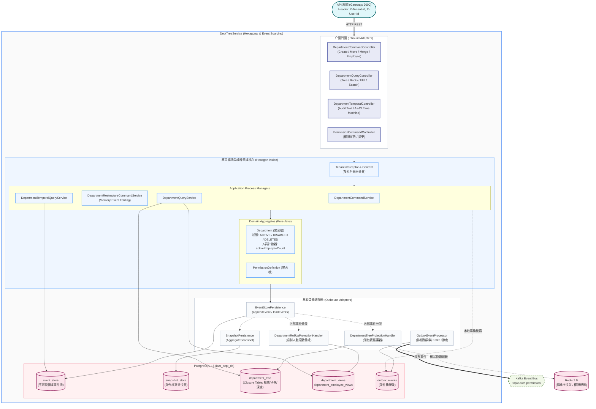

# DeptTreeService (企業級組織樹與權限大腦微服務)

> **定位**：基於戰術領域驅動設計 (Tactical DDD)、極致 CQRS、事件溯源 (Event Sourcing) 與閉包表 (Closure Table) 建構的高併發企業級組織樹架構與權限字典中樞。

---

## 目錄 (Table of Contents)
- [核心定位與職責](#核心定位與職責)
- [核心技術生態 (Tech Stack)](#核心技術生態-tech-stack)
- [系統架構藍圖 (Architecture Blueprint)](#系統架構藍圖-architecture-blueprint)
- [核心架構亮點與硬核設計](#核心架構亮點與硬核設計)
  - [1. 戰術領域驅動設計 (Tactical DDD) 與輕量化聚合根](#1-戰術領域驅動設計-tactical-ddd-與輕量化聚合根)
  - [2. 100% 寫入端純潔性與命令端記憶體投影 (Event Folding)](#2-100-寫入端純潔性與命令端記憶體投影-event-folding)
  - [3. 事件溯源 (Event Sourcing) 與快照優化機制](#3-事件溯源-event-sourcing-與快照優化機制)
  - [4. 閉包表拓撲引擎 (Closure Table Topology) 與 O(1) 幾何操作](#4-閉包表拓撲引擎-closure-table-topology-與-o1-幾何操作)
  - [5. 時光機回溯與歷史狀態任意點還原 (Time Machine)](#5-時光機回溯與歷史狀態任意點還原-time-machine)
  - [6. 發件箱模式 (Outbox Pattern) 與跨服務權限發布](#6-發件箱模式-outbox-pattern-與跨服務權限發布)
  - [7. 雙軌聯防全動態權限防護 (Shared Kernel Pattern)](#7-雙軌聯防全動態權限防護-shared-kernel-pattern)
- [系統目錄結構 (Hexagonal View)](#系統目錄結構-hexagonal-view)
- [RESTful API 完整規格清單](#restful-api-完整規格清單)
  - [1. 部門寫入端 API (Department Command)](#1-部門寫入端-api-department-command)
  - [2. 部門讀取端 API (Department Query)](#2-部門讀取端-api-department-query)
  - [3. 時光機與稽核 API (Temporal & Audit Trail)](#3-時光機與稽核-api-temporal--audit-trail)
  - [4. 權限定義宣告端 API (Permission Command)](#4-權限定義宣告端-api-permission-command)
  - [5. API 資源規則動態管理台 (ApiResourceRule Admin)](#5-api-資源規則動態管理台-apiresourcerule-admin)
- [領域事件與 Kafka 總線合約](#領域事件與-kafka-總線合約)
- [環境準備與啟動指南 (Getting Started)](#環境準備與啟動指南-getting-started)

---

## 核心定位與職責

在大型企業與 SaaS 平台中，組織樹面臨著**「組織頻繁併購與合併（Merge）」**、**「部門整批遷移（Move）」**、**「無限層級樹遍歷效率低下（$N+1$ 遞迴）」**以及**「人員異動資料庫併發死鎖（Deadlock）」**等經典難題。

`DeptTreeService` 徹底摒棄傳統關聯表的貧血 CRUD，作為組織樹與權限的核心大腦：

1. **零鎖併發組織重組 (Lock-Free Org Restructuring)**：以 Event Sourcing 為核心，跨部門重組與人員編制大遷移由事件重播瞬間折疊，消滅併發死鎖。
2. **$O(1)$ 閉包表樹拓撲引擎 (Closure Table Engine)**：讀取端以閉包表維護階層，單次 SQL 即可搞定全子樹查詢、祖先血脈巡檢與防禦性循環圖（Cyclic Graph）檢測。
3. **無損歷史時光機 (SSOT Time Machine)**：所有領域事件具備時間戳與版本號，支援從邏輯刪除狀態中滿血復活，並可查詢任意歷史時間點的組織快照。
4. **全域權限字典發布源頭 (Permission Master Source)**：作為權限定義的源頭，透過 Outbox 發布權限異動事件至 Kafka（`topic.auth.permission`），供 `AuthService` 等下游投影同步。

---

## 核心技術生態 (Tech Stack)

* **核心框架**：Java 21, Spring Boot 4.0.6
* **寫入持久化 (Write Side)**：Spring Data JPA, Hibernate, PostgreSQL 15 (`iam_dept_db`)
* **讀取拓撲投影 (Query Side)**：Spring JDBC, Native SQL (Closure Table 幾何查詢)
* **快取與圖形拓撲**：Redis 7.0 + Lettuce (Redis Tree Projection & Rule Cache)
* **消息總線 (EDA)**：Apache Kafka 3.6 (KRaft 模式) & Spring Kafka
* **事件多態序列化**：Jackson ObjectMapper (Polymorphic Event Mixin)
* **安全底座**：`shared-kernel 1.0.0-SNAPSHOT` (雙軌聯防動態授權)

---

## 系統架構藍圖 (Architecture Blueprint)



---

## 核心架構亮點與硬核設計

### 1. 戰術領域驅動設計 (Tactical DDD) 與輕量化聚合根
* **輕量化聚合根 (Lightweight Aggregate)**：
  * `Department` 聚合根刻意不包含任何 `List<Employee>` 實體關聯集合。
  * 人員編制之指派僅透過輕量級計數器 `activeEmployeeCount` 進行 $O(1)$ 的領域不變量防護（如防止人數扣減至負數），徹底消滅大型部門異動或重組時對數萬筆關聯 Row 產生的**資料庫行鎖競爭 (Lock Contention) 與死鎖 (Deadlock)**。
* **高內聚充血模型 (Rich Domain Model)**：
  * 徹底封鎖無參建構子與 Setter。所有狀態流轉邏輯（`moveTo`、`mergeInto`、`restore`、`disable`、`rename`、`assignEmployee`）皆為聚合根內部方法。
* **強型態值物件隔離 (Value Objects)**：
  * `TenantId`、`DepartmentId`、`DepartmentCode`、`DepartmentStatus`、`PermissionCode`，從領域核心徹底瓦解 IDOR 越權。

### 2. 100% 寫入端純潔性與命令端記憶體投影 (Event Folding)
* **寫入端零視圖依賴 (No Query-Side Dependency)**：
  * 寫入端命令服務絕不注入任何 `_view` 或讀取端投影表。
* **記憶體事件折疊 (In-Memory Event Folding)**：
  * 在執行如「部門合併（Merge）」這種跨聚合根的重量級業務時，`DepartmentRestructureCommandService` 透過命令端重播歷史事件流，於**記憶體中折疊出當下人員名單**，並推演出 `DepartmentMergedEvent`，兼顧極致效能與 100% 強一致性。

### 3. 事件溯源 (Event Sourcing) 與快照優化機制
* **單一真實來源 (Single Source of Truth, SSOT)**：
  * 資料庫中不存在傳統的 `UPDATE` 或 `DELETE` 操作。聚合根所有的狀態改變皆化為不可變的 `DomainEvent`，追加寫入 `event_store` 物理表。
* **非同步快照調度器 (`SnapshotAsyncDispatcher`)**：
  * 當事件流長度達到閾值（如每 50 個事件），非同步寫入 `snapshot_store` 記錄聚合根當下的 Memory Snapshot。
  * 還原聚合根時，系統直接加載最新快照，並僅重播快照時間點後的差量事件，使加載時間維持在穩定的微秒級別。

### 4. 閉包表拓撲引擎 (Closure Table Topology) 與 O(1) 幾何操作
樹狀架構在關聯式資料庫中若採用鄰接表（`parent_id`），在查詢子樹時必然引發多次遞迴或重型 CTE。本系統引進專業級**閉包表 (`department_tree`)**：

* **閉包表結構**：
  * `ancestor_id` (祖先節點)
  * `descendant_id` (子孫節點)
  * `depth` (兩節點間的相對深度距離；自指深度為 `0`)
  * `tenant_id` (租戶分區維度)
* **極致查詢優勢**：
  * **全子樹查詢**：`WHERE ancestor_id = :id`，一發 SQL 抓出全子孫節點。
  * **祖先血脈巡檢 (Breadcrumbs)**：`WHERE descendant_id = :id ORDER BY depth DESC`，秒級返回完整麵包屑路徑。
  * **防禦性循環檢測 (Cycle Detection)**：移動節點至目標節點前，檢驗 `WHERE ancestor_id = :targetId AND descendant_id = :sourceId`。若存在紀錄代表目標是自身的子孫，立即阻斷，**防禦成環死循環災難**。

### 5. 時光機回溯與歷史狀態任意點還原 (Time Machine)
* **歷史事件稽核軌跡 (Audit Log)**：
  * `GET /api/departments/{tenantId}/{id}/events` 返回該部門生命週期內所有的異動事件流。
* **任意時間點快照重建 (As-Of Reconstruction)**：
  * `GET /api/departments/{tenantId}/{id}/as-of?timestamp=...` 支援傳入任意歷史時間戳記。
  * 引擎精確重播該時間點之前的歷史事件，於記憶體還原該部門在歷史當下的名稱、上層部門與編制狀態，提供無可挑剔的法遵與審計證明力。
* **滿血復活 (Restore)**：
  * 支援從邏輯刪除狀態中復活，並具備自動回歸頂層 Root 的拓撲防禦機制，杜絕幽靈孤兒節點。

### 6. 發件箱模式 (Outbox Pattern) 與跨服務權限發布
* **跨服務權限字典通知**：
  * 當本服務定義全新權限（如 `DEPT_MANAGE`）時，產出 `PermissionDefinitionCreatedEvent`。
  * 透過 `outbox_events` 表與本機事務保證 At-least-once 交付，由 `OutboxEventProcessor` 定時輪詢發布至 Kafka `topic.auth.permission`。
  * 下游的 `AuthService` 接收後，依據事件內的版本號以高水位線防禦更新自身投影。

### 7. 雙軌聯防全動態權限防護 (Shared Kernel Pattern)
* **依賴反轉隔離**：引入 `shared-kernel` 安全套件，透過抽象的 `ApiResourceRuleQueryRepositoryPort` 進行 AntPath 路徑鑑權。
* **熱更新 API 權限管控 (Hot-Reload Access Control)**：
  * 管理員透過 `/api/departments/api-rules` 即時增修 API 存取權限規則。
  * `ApiRuleCacheEvictionListener` 自動觸發 Redis Key Pattern 驅逐，全域節點微秒級感知最新安全策略。

---

## 系統目錄結構 (Hexagonal View)

```text
dept-tree-service/src/main/java/com/example/demo/
├── DepartmentTreeServiceApplication.java     # 微服務主啟動入口
│
├── application/                             # 【核心內部】Application & Domain Core
│   ├── dispatcher/                          # SnapshotAsyncDispatcher 非同步快照調度
│   ├── domain/                              # 1. 領域層 (Pure Java POJO)
│   │   ├── dept/                            # Department 聚合根、VOs、Events、Repo Port
│   │   ├── permission/                      # PermissionDefinition 聚合根、Events
│   │   └── shared/                          # BaseAggregateRoot, DomainEvent, TenantId
│   ├── event/                               # 2. 領域事件投影監聽處理器
│   │   ├── DepartmentTreeProjectionHandler.java  # 異步維護閉包表 (Closure Table)
│   │   ├── DepartmentRollUpProjectionHandler.java# 人員編制階層滾動彙總
│   │   └── ApiRuleCacheEvictionListener.java     # Redis 權限快照安全驅逐
│   ├── port/                                # 3. 驅動與被動埠 (Inbound / Outbound Ports)
│   │   ├── DepartmentTreeQueryPort.java
│   │   ├── EventStorePort.java
│   │   ├── OutboxProcessorPort.java
│   │   └── AggregateSnapshotPort.java
│   ├── service/                             # 4. 流程編排服務 (Process Managers)
│   │   ├── DepartmentCommandService.java
│   │   ├── DepartmentRestructureCommandService.java # 記憶體事件折疊合併大腦
│   │   ├── DepartmentQueryService.java
│   │   ├── DepartmentTemporalQueryService.java     # 時光機查詢服務
│   │   ├── PermissionCommandService.java
│   │   └── ApiResourceRuleCommandService.java
│   └── shared/                              # Commands, Results, DTOs
│
├── iface/                                   # 【外圈輸入】Inbound Adapters
│   ├── rest/                                # RESTful Controllers
│   │   ├── DepartmentCommandController.java # 部門寫入端 (變更狀態)
│   │   ├── DepartmentQueryController.java   # 部門讀取端 (樹、閉包快查)
│   │   ├── DepartmentTemporalController.java# 時光機與事件軌跡查詢
│   │   ├── PermissionCommandController.java # 權限定義宣告
│   │   └── ApiResourceRuleAdminController.java# API 資源防護規則管理
│   ├── interceptor/                         # TenantInterceptor 多租戶注入
│   ├── filter/                              # TraceId 與權限透傳 Filter
│   └── schedule/                            # OutboxEventProcessor 發件箱排程
│
└── infra/                                   # 【外圈輸出】Outbound Adapters & Persistence
    ├── adapter/                             # EventStoreAdapter, KafkaPublisher 等實作
    ├── event/sourcing/                      # StoredEvent 物理實體表
    ├── snapshot/                            # AggregateSnapshot 快照實體表
    ├── projection/                          # DepartmentTree (閉包表), DepartmentView 實體
    ├── persistence/                         # JPA Repositories
    ├── outbox/                              # OutboxEvent 發件箱實體
    └── distlock/                            # 分散式鎖資料庫實作
```

---

## RESTful API 完整規格清單

### 1. 部門寫入端 API (Department Command)
> *所有寫入接口均強制自 Header 提取 `X-Tenant-Id` 與 `X-User-Id` (操作者稽核身分)。*

| HTTP Method | API Endpoint | 描述 | 核心業務行為與事件 |
| :--- | :--- | :--- | :--- |
| `POST` | `/api/departments` | 建立單一部門 | 發布 `DepartmentCreatedEvent`，閉包表寫入自指深度 `0` |
| `POST` | `/api/departments/tree` | 批量建立整棵組織樹 | 依父子階層遞歸持久化並完成閉包拓撲裝配 |
| `PATCH` | `/api/departments/{id}/name` | 部門更名 | 發布 `DepartmentRenamedEvent` |
| `PATCH` | `/api/departments/{id}/move` | 移動部門掛載點 | 防禦性循環圖檢測，發布 `DepartmentMovedEvent`，重繪閉包表子樹 |
| `POST` | `/api/departments/{id}/merge` | **重磅：部門合併 (Merge)** | **記憶體事件折疊**，平移員工與子部門，發布 `DepartmentMergedEvent` |
| `DELETE` | `/api/departments/{id}` | 邏輯刪除部門 | 標記為 `DELETED`，發布 `DepartmentDeletedEvent` |
| `POST` | `/api/departments/{id}/restore` | **時光機滿血復活** | 復原刪除狀態，防禦孤兒節點自動掛載 Root，發布 `DepartmentRestoredEvent` |
| `PATCH` | `/api/departments/{id}/disable` | 停用部門 | 標記為 `DISABLED`，發布 `DepartmentDisabledEvent` |
| `PATCH` | `/api/departments/{id}/sort-order` | 調整兄弟節點排序 | 發布 `DepartmentSortOrderChangedEvent` |
| `POST` | `/api/departments/{id}/employees` | 指派同仁至部門 | 計數器 $+1$，發布 `EmployeeAssignedToDepartmentEvent` |
| `DELETE` | `/api/departments/{id}/employees/{employeeId}` | 將同仁移出部門 | 計數器 $-1$，發布 `EmployeeUnassignedFromDepartmentEvent` |

### 2. 部門讀取端 API (Department Query)
| HTTP Method | API Endpoint | 描述 | 效能亮點與說明 |
| :--- | :--- | :--- | :--- |
| `GET` | `/api/departments/{tenantId}/{id}/tree` | **完整 N 階層巢狀樹視圖** | **單次 SQL 直擊閉包表**，記憶體裝配 `children`，附帶預先滾動統計之總人數 |
| `GET` | `/api/departments/{tenantId}/roots` | 查詢租戶所有頂層 Root 部門 | 快查深度為 `0` 且無更上層祖先之根節點清單 |
| `GET` | `/api/departments/{tenantId}/{id}/hierarchy` | **祖先血脈巡檢 (Breadcrumbs)** | 依 `depth DESC` 排序，獲取從根節點到當下節點的完整路徑 |
| `GET` | `/api/departments/{tenantId}/search` | 部門名稱關鍵字搜尋 | 分頁檢索租戶內合法部門 |
| `GET` | `/api/departments/{tenantId}/flat` | 全量扁平部門清單 | 供下拉選單（Dropdown）快速綁定使用 |
| `GET` | `/api/departments/{tenantId}/user/{userId}/tree` | 查詢同仁專屬權限可視樹 | 依同仁職級與數據權限範圍過濾子樹視圖 |

### 3. 時光機與稽核 API (Temporal & Audit Trail)
| HTTP Method | API Endpoint | 描述 | 說明 |
| :--- | :--- | :--- | :--- |
| `GET` | `/api/departments/{tenantId}/{id}/events` | **部門全量異動稽核時間軸** | 讀取 Event Store，返回自誕生起的所有不可變領域事件流 |
| `GET` | `/api/departments/{tenantId}/{id}/as-of` | **特定歷史時刻狀態還原** | 傳入 `timestamp=2026-01-01T00:00:00Z`，重播推演出歷史快照 |

### 4. 權限定義宣告端 API (Permission Command)
| HTTP Method | API Endpoint | 描述 | 說明 |
| :--- | :--- | :--- | :--- |
| `POST` | `/api/departments/permissions` | 自動宣告/等冪建立權限點 | 寫入後透過 Outbox 發布至 Kafka `topic.auth.permission` |
| `PUT` | `/api/departments/permissions/{code}` | 更新權限名稱與模組描述 | 觸發 `PermissionDefinitionUpdatedEvent` |

### 5. API 資源規則動態管理台 (ApiResourceRule Admin)
> *本模組受 `@RequiresPermission("platform:RULE_MANAGE")` 最高權限保護。*

| HTTP Method | API Endpoint | 描述 | 說明 |
| :--- | :--- | :--- | :--- |
| `POST` | `/api/departments/api-rules` | 新增 API 存取安全規則 | 設定 AntPath 匹配路徑、HTTP Method 與所需權限字串 |
| `PUT` | `/api/departments/api-rules/{ruleId}` | 調整現存規則內容 | 異動時自動驅逐 Redis 快取，達成即時全域生效 |
| `PATCH` | `/api/departments/api-rules/{ruleId}/status` | 啟用 / 凍結單項規則 | 線上熱切換 API 門檻狀態 |

---

## 領域事件與 Kafka 總線合約

### 1. 核心發布事件 (Published Domain Events)
由 `OutboxEventProcessor` 輪詢發布至 Kafka：
* **`PermissionDefinitionCreatedEvent`**：發布至 `topic.auth.permission`，通知 `AuthService` 等下游同步全域權限字典。
* **`PermissionDefinitionUpdatedEvent`**：權限描述更名廣播。
* **`DepartmentMergedEvent`**：部門合併完成廣播，內含被合併部門、目標接收部門、以及受影響同仁名單。
* **`DepartmentMovedEvent`**：部門階層遷移廣播。

### 2. 事件不可變定律 (Event Immutability Norm)
所有宣告之 `DomainEvent` 實體均實作強型態唯讀契約：
1. 必須具備 `tenantId` (多租戶隔離識別碼)。
2. 必須具備 `occurredOn` (高精度事件發生時間戳記)。
3. 必須具備 `version` (樂觀鎖水位線版本號)。

---

## 環境準備與啟動指南 (Getting Started)

### 1. 本地 Maven 依賴確認
確認本地已安裝核心安全模組 `shared-kernel`：
```bash
cd ../shared-kernel
mvn clean install
```

### 2. 基礎設施就緒確認
* **PostgreSQL 15**：監聽 `5432`，資料庫為 `iam_dept_db`。
* **Redis 7.0**：監聽 `6379`，密碼為 `iam_redis_pass`。
* **Kafka 3.6 (KRaft)**：監聽 `9092`。

### 3. 設定檔說明 (`application.properties`)
```properties
spring.application.name=dept-tree-module
server.port=8081

# 資料庫連線
spring.datasource.url=jdbc:postgresql://localhost:5432/iam_dept_db
spring.datasource.username=postgres
spring.datasource.password=postgres
spring.jpa.hibernate.ddl-auto=create

# Kafka 連線
spring.kafka.bootstrap-servers=localhost:9092
spring.kafka.producer.acks=1

# Redis 連線
spring.data.redis.host=localhost
spring.data.redis.port=6379
spring.data.redis.password=iam_redis_pass
```

### 4. 編譯與啟動微服務
在 `dept-tree-service` 目錄下執行：

```bash
# 透過 Maven Wrapper 啟動 (Linux / macOS)
./mvnw spring-boot:run

# 於 Windows PowerShell 啟動
.\mvnw.cmd spring-boot:run
```

服務將啟動並監聽於 **Port `8081`**，所有對外請求由 API 網關（Port `9000`）進行轉發。
