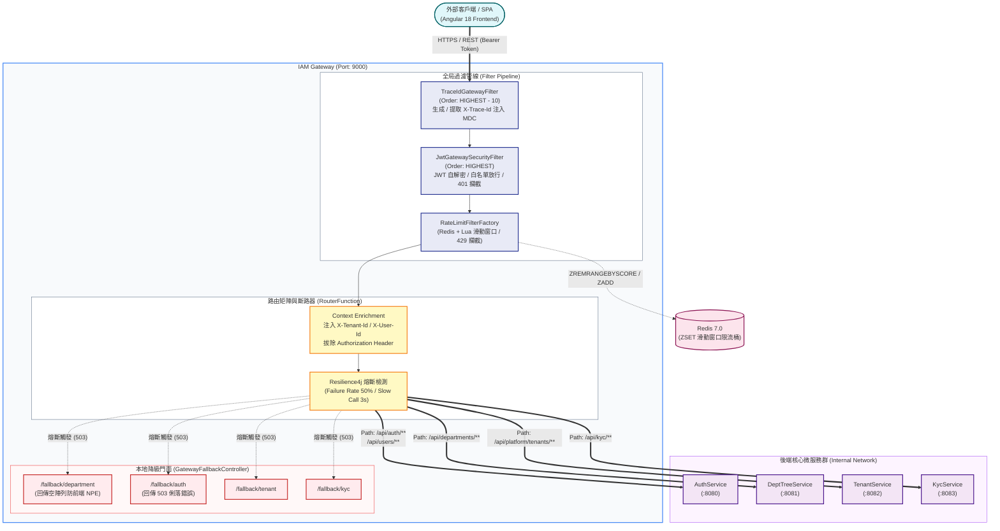

# IAM Gateway (全域 API 流量網關與安全護城河)

> **定位**：微服務叢集的單一流量入口，整合分散式全鏈路追蹤、零信任無狀態 JWT 鑑權、上下文傳播、Redis 毫秒級滑動窗口限流、以及 Resilience4j 斷路熔斷防護。

---

## 目錄 (Table of Contents)
- [核心定位與職責](#核心定位與職責)
- [核心技術生態 (Tech Stack)](#核心技術生態-tech-stack)
- [網關架構拓撲圖 (Gateway Architecture Blueprint)](#網關架構拓撲圖-gateway-architecture-blueprint)
- [核心安全與防禦亮點](#核心安全與防禦亮點)
  - [1. 全鏈路分散式追蹤碼 (Distributed TraceId & MDC)](#1-全鏈路分散式追蹤碼-distributed-traceid--mdc)
  - [2. 零信任無狀態 JWT 鑑權與白名單過濾 (Zero-Trust JWT)](#2-零信任無狀態-jwt-鑑權與白名單過濾-zero-trust-jwt)
  - [3. 安全上下文傳播與 Token 剝除 (Context Propagation & Token Stripping)](#3-安全上下文傳播與-token-剝除-context-propagation--token-stripping)
  - [4. Redis + Lua 毫秒級分散式滑動窗口限流 (Sliding Window Rate Limiter)](#4-redis--lua-毫秒級分散式滑動窗口限流-sliding-window-rate-limiter)
  - [5. Resilience4j 斷路熔斷與前端防崩降級 (Circuit Breaker & Fallback)](#5-resilience4j-斷路熔斷與前端防崩降級-circuit-breaker--fallback)
- [路由矩陣與轉發拓撲 (Routing Matrix)](#路由矩陣與轉發拓撲-routing-matrix)
- [系統目錄結構 (Project Structure)](#系統目錄結構-project-structure)
- [標準化響應結構 (Standard Gateway Response)](#標準化響應結構-standard-gateway-response)
- [環境準備與啟動指南 (Getting Started)](#環境準備與啟動指南-getting-started)

---

## 核心定位與職責

在分散式微服務生態系中，`iam-gateway` 承擔著**最外圈防禦工事與流量中繼樞紐**的關鍵角色：

1. **唯一公共流量入口 (Single Entrypoint)**：作為叢集的對外統一端口（Port `9000`），對外隱藏所有後端微服務的具體拓撲與內部 IP。
2. **零信任無狀態自解密 (Decentralized Auth)**：在最前端以微秒級速度校驗 JWT Token 合法性，非法請求在網關層即時阻斷，絕不浪費下游服務運算資源。
3. **安全上下文下穿 (Context Propagation)**：萃取 JWT 內的 `tenantId`、`username`、`authorities`，轉換並安全覆寫為 `X-Tenant-Id`、`X-User-Id`、`X-User-Permissions` 注入轉發標頭，並徹底拔除原始 Token，維護內部純粹信任。
4. **高併發防護網 (Rate Limiting & Circuit Breaking)**：透過 Redis ZSET 滑動窗口限流防禦爆破與 DoS 攻擊；搭配 Resilience4j 熔斷器防止單一微服務雪崩拖垮全系統。
5. **端到端可觀測性 (Observability)**：貫徹 `X-Trace-Id` 分散式追蹤，串聯網關與下游日誌。

---

## 核心技術生態 (Tech Stack)

* **核心框架**：Java 21, Spring Boot 4.0.7
* **網關引擎**：Spring Cloud 2025.1.2 (`spring-cloud-starter-gateway-server-webmvc`)
* **斷路器與容錯**：Resilience4j (`spring-cloud-starter-circuitbreaker-resilience4j`)
* **快取與分散式限流**：Redis 7.0 + Lettuce 連線池 (`spring-boot-starter-data-redis`)
* **安全與認證**：Auth0 `java-jwt 4.5.2` (HMAC256 對稱金鑰無狀態驗證)
* **鏈路追蹤**：SLF4J MDC (Mapped Diagnostic Context) + 自研 `TraceIdGatewayFilter`

---

## 網關架構拓撲圖 (Gateway Architecture Blueprint)



---

## 核心安全與防禦亮點

### 1. 全鏈路分散式追蹤碼 (Distributed TraceId & MDC)
* **入口生成與繼承 (`TraceIdGatewayFilter`)**：
  * 作為全網關第一優先級過濾器（`Ordered.HIGHEST_PRECEDENCE - 10`）。
  * 若前端或前置反向代理帶有 `X-Trace-Id` 則予以繼承；若無則自動生成 32 碼無橫槓 UUID。
* **MDC 綁定與日誌輸出**：
  * 將 TraceId 注入 SLF4J 的 `MDC` 容器，控制台日誌格式統一格式化為 `[TraceId: %X{traceId}]`。
* **包裝透傳與安全抹除**：
  * 透過 `MutableHttpServletRequest` 將 `X-Trace-Id` 注入下游請求頭。
  * 在 `finally` 區塊強制執行 `MDC.remove("traceId")`，防止 Tomcat 線程池復用時產生鏈路污染。

### 2. 零信任無狀態 JWT 鑑權與白名單過濾 (Zero-Trust JWT)
* **無狀態去中心化驗證 (`JwtGatewaySecurityFilter`)**：
  * 採用 HMAC256 對稱加密演算法，於網關最外層進行毫秒級自解密驗證。
  * 非法、竄改或過期的 Token 直接原地以 HTTP 401 Unauthorized 回絕，保護內部服務不被無效請求穿透。
* **公共豁免白名單 (Whitelist)**：
  * 精確放行公共訪問接口：`/api/auth/login`、`/api/auth/register`、`/api/platform/tenants`、Actuator 健康監控與 Swagger/OpenAPI 文檔路徑。
* **解耦傳遞機制**：
  * 驗證通過後，將 `username`、`tenantId`、`authorities` 暫存於 Servlet Request Attribute，交由後續路由矩陣完成 Header 封裝，免除傳統 RequestWrapper 在 SCG WebMvc 下可能遭遇的轉發丟失問題。

### 3. 安全上下文傳播與 Token 剝除 (Context Propagation & Token Stripping)
* **防覆蓋 Header 注入**：
  * 在路由矩陣層使用 `.set()` 強制覆寫 `X-Tenant-Id`、`X-User-Id` 與 `X-User-Permissions`，徹底封殺客戶端自行偽造 Header 或因多次轉發造成的 `WPG,WPG` 逗號堆疊漏洞。
* **Token 剝除原則 (Token Stripping)**：
  * 請求出站前強制移除 `Authorization` 標頭（`httpHeaders.remove("Authorization")`）。
  * 下游微服務不再承擔重複解析 Token 的負擔，亦無法直接讀取原始 Token，達成嚴格的「邊界驗證、內部信任」零信任模型。

### 4. Redis + Lua 毫秒級分散式滑動窗口限流 (Sliding Window Rate Limiter)
* **策略模式設計 (`GatewayRateLimiterPort`)**：
  * 提供 `RedisRateLimiterAdapter`（叢集主力）與 `MemoryRateLimiterAdapter`（單機備援）雙實作，可透過設定檔彈性切換。
* **Redis Sorted Set (ZSET) + Lua 原子防線**：
  * 採用滑動窗口演算法（Sliding Window），以毫秒時間戳為 Score 與 Member。
  * 執行 Lua 腳本於單次原子操作內完成三部曲：
    1. `ZREMRANGEBYSCORE key 0 clear_before`：清除窗口外過期請求。
    2. `ZCARD key`：計算當前窗口總請求次數。
    3. `ZADD key now now` + `EXPIRE`：未超額則寫入並展延 Key 壽命。
* **精準 IP 與路由維度隔離**：
  * Key 格式：`RATE_LIMIT:{routeId}:IP:{clientIp}`，各業務端點流量相互隔離。
  * 放行時附加 `X-RateLimit-Remaining` 標頭。
  * 超額時回傳 HTTP 429 Too Many Requests，附帶 `X-RateLimit-Retry-After` 與標準 JSON。

### 5. Resilience4j 斷路熔斷與前端防崩降級 (Circuit Breaker & Fallback)
* **服務熔斷機制**：
  * 各下游服務配置專屬熔斷器（`authCircuitBreaker`、`deptCircuitBreaker`、`kycCircuitBreaker`、`tenantCircuitBreaker`）。
  * 滑動窗口內錯誤率達 50% 或慢調用（超過 3 秒）達 70% 時，自動引爆熔斷進入 `OPEN` 狀態，10 秒後進入 `HALF_OPEN` 探測。
* **就地降級保護 (`GatewayFallbackController`)**：
  * **組織樹防崩特點**：當部門服務（Port 8081）超時或死機時，`/fallback/department` 就地回傳合法的**空陣列清單 (`[]`)**，防止前端 Angular Tree 元件因收到非陣列物件觸發 JavaScript NPE 導致整頁渲染白屏。
  * **認證中心降級**：回傳標準 503 Service Unavailable 與友善提示訊息。

---

## 路由矩陣與轉發拓撲 (Routing Matrix)

網關統一監聽於 **Port `9000`**，依據路徑前綴分流轉發：

| 路由標識 (Route ID) | 匹配路徑 (Path Predicates) | 目標目標位址 (Target URI) | 限流配額 (Rate Limit) | 專屬斷路器 (Circuit Breaker) | 降級路由 (Fallback) |
| :--- | :--- | :--- | :--- | :--- | :--- |
| **auth-public-route** | `/api/auth/**` | `http://localhost:8080` | 3 次 / 10 秒 | `authCircuitBreaker` | `/fallback/auth` |
| **auth-admin-route** | `/api/users/**`<br/>`/api/roles/**`<br/>`/api/groups/**`<br/>`/api/permissions/**` | `http://localhost:8080` | 10 次 / 10 秒 | `authCircuitBreaker` | `/fallback/auth` |
| **department-service-route** | `/api/departments/**` | `http://localhost:8081` | 10 次 / 10 秒 | `deptCircuitBreaker` | `/fallback/department` |
| **tenant-service-route** | `/api/v1/platform/tenants/**`<br/>`/api/platform/tenants/**` | `http://localhost:8082` | 5 次 / 10 秒 | `tenantCircuitBreaker` | `/fallback/tenant` |
| **kyc-service-route** | `/api/kyc/**` | `http://localhost:8083` | 10 次 / 10 秒 | `kycCircuitBreaker` | `/fallback/kyc` |
| **global-baseline** | 全局所有出站請求 | — | 50 次 / 1 秒 | — | — |

---

## 系統目錄結構 (Project Structure)

```text
iam-gateway/src/main/java/com/example/demo/
├── IamGatewayApplication.java               # 網關服務主啟動入口
│
├── application/
│   └── port/
│       └── GatewayRateLimiterPort.java      # 限流器策略模式抽象合約 (Strategy Port)
│
├── config/
│   └── GatewayRoutesConfiguration.java      # 全局路由矩陣、Header 注入與斷路器編排
│
├── iface/                                   # 外圈過濾與降級門面
│   ├── dto/
│   │   └── GatewayResponse.java             # 標準化網關 JSON 響應封裝體
│   ├── filter/
│   │   ├── TraceIdGatewayFilter.java        # MDC 全鏈路追蹤碼守門員 (Order: -10)
│   │   └── JwtGatewaySecurityFilter.java    # JWT 無狀態自解密與白名單過濾 (Order: 0)
│   └── rest/
│       └── GatewayFallbackController.java   # 斷路器觸發後之本地優雅降級門面
│
└── infra/                                   # 基礎設施層 (限流適配器)
    ├── adapter/
    │   ├── RedisRateLimiterAdapter.java     # Redis ZSET + Lua 分散式滑動窗口限流實作
    │   └── MemoryRateLimiterAdapter.java    # 本地 ConcurrentHashMap 備援限流實作
    └── ratelimit/
        └── RateLimitFilterFactory.java      # IP 維度限流 HandlerFilter 工廠
```

---

## 標準化響應結構 (Standard Gateway Response)

網關於自攔截（如 401 鑑權失敗、429 觸發限流、503 熔斷降級）時，均回傳標準結構：

### 1. 限流攔截響應 (HTTP 429 Too Many Requests)
```json
{
  "code": "IAM-429-RATE-LIMIT",
  "message": "您的請求過於頻繁，已觸發安全限流機制，請於 10 秒後再試。"
}
```

### 2. 認證失敗響應 (HTTP 401 Unauthorized)
```json
{
  "error": "Missing or invalid Authorization header."
}
```

### 3. 熔斷降級響應 (HTTP 503 Service Unavailable)
```json
{
  "code": "IAM-503-DEPT-MUTED",
  "message": "部門服務運算超時或暫時不可用，網關已啟動動態安全防護，請稍後再試。",
  "data": []
}
```

---

## 環境準備與啟動指南 (Getting Started)

### 1. 前置依賴與基礎設施確認
確認本機 Docker 基礎設施中的 Redis 已啟動：
* **Redis 7.0**：監聽 `localhost:6379`，連線密碼預設為 `iam_redis_pass`。

### 2. 關鍵配置說明 (`application.yml`)
```yaml
server:
  port: 9000

app:
  jwt:
    # 必須與 AuthService 完全對齊，以確保自解密正確性
    secret: "FRaNlJmM1RzRlNhYl123FRaNlJmM1RzRlNhYl123898"

spring:
  data:
    redis:
      host: localhost
      port: 6379
      password: iam_redis_pass
```

### 3. 編譯與啟動微服務
在 `iam-gateway` 專案目錄下執行：

```bash
# 透過 Maven Wrapper 啟動 (Linux / macOS)
./mvnw spring-boot:run

# 於 Windows PowerShell 啟動
.\mvnw.cmd spring-boot:run
```

服務啟動後，前端與對外流量請統一發往 `http://localhost:9000`。
