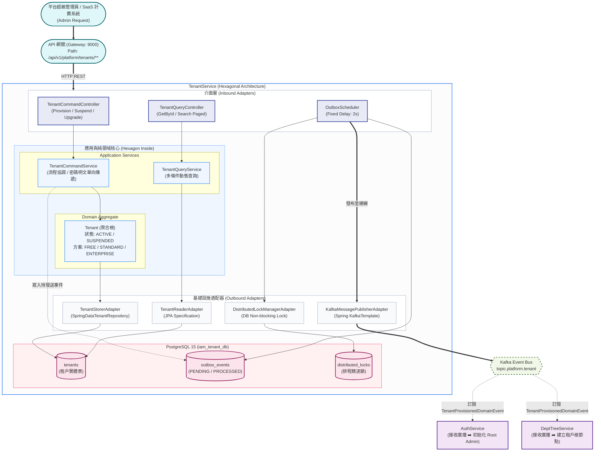

# TenantService (SaaS 租戶入駐與平台樞紐微服務)

> **定位**：SaaS 平台的核心源頭樞紐，掌管企業租戶的生命週期狀態機（開通、計費方案升級、停權、續約），並透過發件箱模式 (Outbox Pattern) 向 Kafka 廣播租戶開通整合事件，驅動全微服務叢集的租戶空間聯動初始化。

---

## 目錄 (Table of Contents)
- [核心定位與職責](#核心定位與職責)
- [核心技術生態 (Tech Stack)](#核心技術生態-tech-stack)
- [系統架構藍圖 (Architecture Blueprint)](#系統架構藍圖-architecture-blueprint)
- [核心架構亮點與硬核設計](#核心架構亮點與硬核設計)
  - [1. 戰術領域驅動設計 (Tactical DDD 充血模型)](#1-戰術領域驅動設計-tactical-ddd-充血模型)
  - [2. 嚴格六角架構 (Hexagonal / Clean Architecture)](#2-嚴格六角架構-hexagonal--clean-architecture)
  - [3. 跨系統開通廣播與事件溯源 (EDA Provisioning)](#3-跨系統開通廣播與事件溯源-eda-provisioning)
  - [4. 發件箱模式 (Outbox Pattern) 與分散式排程鎖](#4-發件箱模式-outbox-pattern-與分散式排程鎖)
  - [5. 靈活的計費方案契約 (PlanType & Expiry Management)](#5-靈活的計費方案契約-plantype--expiry-management)
- [模組目錄結構 (Hexagonal View)](#模組目錄結構-hexagonal-view)
- [RESTful API 完整規格清單](#restful-api-完整規格清單)
  - [1. 租戶寫入端 API (Tenant Command)](#1-租戶寫入端-api-tenant-command)
  - [2. 租戶讀取端 API (Tenant Query)](#2-租戶讀取端-api-tenant-query)
- [領域事件與 Kafka 總線合約](#領域事件與-kafka-總線合約)
- [環境準備與啟動指南 (Getting Started)](#環境準備與啟動指南-getting-started)

---

## 核心定位與職責

在多租戶（Multi-Tenant）企業架構中，所有業務邊界、數據隔離以及身分認證的前提，均取決於**「合法租戶是否存在」**。

`TenantService` 處於整體微服務體系的**最源頭與生命週期頂層**：

1. **租戶生命週期狀態機 (Tenant Lifecycle State Machine)**：嚴格管控企業租戶從 `ACTIVE`（正常運作）、`SUSPENDED`（欠費/停權）到合約過期之狀態躍遷。
2. **多租戶開通事件發射源 (Provisioning Event Dispatcher)**：當新租戶入駐完成時，在同事務寫入 `TenantProvisionedDomainEvent`，透過 Outbox 發布至 Kafka `topic.platform.tenant`，觸發下游服務（`AuthService`、`DeptTreeService`、`KYCService`）完成租戶空間與初始管理員的自動化初始化。
3. **平台級租戶檢索 (Platform Tenant Query)**：提供平台超級管理員（Platform Admin）支援多維度條件（公司名稱、計費方案、狀態、過期日）的高效分頁列表與單一租戶詳情查詢。
4. **分散式鎖保護之發件箱排程 (Reliable Outbox Engine)**：內建基於關係型資料庫之非阻塞分散式鎖，確保多節點橫向擴展部署時 Outbox 輪詢作業不併發衝突。

---

## 核心技術生態 (Tech Stack)

* **核心框架**：Java 21, Spring Boot 4.0.7
* **持久化技術**：Spring Data JPA, Hibernate, PostgreSQL 15 (`iam_tenant_db`)
* **消息中介 (EDA)**：Apache Kafka 3.6 (KRaft 模式) & Spring Kafka
* **分散式鎖定**：關係型資料庫非阻塞排程鎖 (`DistributedLockRepository`)
* **資料序列化**：Jackson JSR-310 (JavaTimeModule)
* **架構風格**：Hexagonal Architecture (Ports and Adapters), Tactical DDD, Outbox Pattern

---

## 系統架構藍圖 (Architecture Blueprint)



---

## 核心架構亮點與硬核設計

### 1. 戰術領域驅動設計 (Tactical DDD 充血模型)
* **純粹領域聚合根 (Pure POJO Aggregate Root)**：
  * `Tenant` 聚合根位於 `application/domain` 核心，完全不包含任何 JPA 註解，捍衛 100% 領域純潔度。
* **高內聚商業狀態機**：
  * 徹底拔除公共 Setter。所有狀態流轉邏輯封裝於具體領域方法中：
    * `provisionNew(...)`：驗證企業基本資料，產生初始合約到期日，並記錄 `TenantProvisionedDomainEvent`。
    * `upgradePlan(newPlan)`：驗證計費方案升級邏輯。
    * `suspend(reason)`：將租戶打上 `SUSPENDED` 狀態，拒絕未授權存取，並發布 `TenantSuspendedDomainEvent`。
* **強型態值物件 (Value Objects)**：
  * `TenantId`（強型態主鍵）、`PlanType`（`FREE`、`STANDARD`、`PROFESSIONAL`、`ENTERPRISE`）、`TenantStatus`（`ACTIVE`、`SUSPENDED`、`TERMINATED`）。

### 2. 嚴格六角架構 (Hexagonal / Clean Architecture)
* **驅動埠與被動埠 (Inbound & Outbound Ports)**：
  * `TenantStorerPort`：持久化租戶實體抽象合約。
  * `TenantReaderPort`：租戶查詢端契約。
  * `MessagePublisherPort`：解耦特定消息佇列技術（Kafka）之抽象廣播合約。
  * `DistributedLockManagerPort`：解耦特定資料庫分散式鎖之抽象排程鎖合約。
* **防腐層轉譯 (Anti-Corruption)**：
  * REST Controller 接收到外部 `TenantRequest` DTO 後，在進入 Application Service 前即轉譯為強型別的 Command 物件（如 `ProvisionTenantCommand`），隔離外圈通訊協議與內圈商業模型。

### 3. 跨系統開通廣播與事件溯源 (EDA Provisioning)
新租戶開通並非單純在資料庫寫入一筆紀錄，而是涉及**整座微服務叢集的聯動初始化**：
1. **開通指令下達**：平台管理員呼叫 `POST /api/platform/tenants`。
2. **領域事件落地**：`Tenant` 聚合根產生 `TenantProvisionedDomainEvent`，內含 `tenantId`、`companyName`、`adminEmail` 與 `plainPassword`（僅一次性傳遞供加密）。
3. **Kafka 廣播解耦**：Outbox 引擎將事件投遞至 `topic.platform.tenant`。
4. **下游微服務自治初始化**：
   * `AuthService`：監聽該主題，利用原子 UPSERT 實作冪等去重後，建立該租戶的初始 Root Admin 帳號並指派 `ADMIN` 最高權限。
   * `DeptTreeService`：自動為該租戶建立頂層 Root 部門節點與基礎組織架構。

### 4. 發件箱模式 (Outbox Pattern) 與分散式排程鎖
* **本地事務雙寫保證 (Local TX Atomicity)**：
  * 租戶資料存檔與發件箱紀錄（`OutboxEventDbEntity`）在同一資料庫交易內原子落地，消滅「資料寫入成功但 MQ 斷線遺失事件」的雙寫不一致性。
* **非阻塞分散式鎖 (`DistributedLockManagerAdapter`)**：
  * 排程器 `OutboxScheduler` 每 2 秒甦醒一次。
  * 透過 `executeWithLock` 向 `distributed_locks` 表搶佔非阻塞排程鎖（`job:outbox-export-lock`，租期 30 秒）。
  * 搶鎖成功之 Pod 獨佔發射任務，未搶到者直接優雅略過，**徹底防止多節點重複撈取引發的併發衝突**。
* **小批次快跑與容錯自癒**：
  * 採每次 20 筆小批次 FIFO 模式發射事件，發送成功標記為 `PROCESSED`；遭遇異常則保留錯誤軌跡，等待下一週期自癒。

### 5. 靈活的計費方案契約 (PlanType & Expiry Management)
* **多層級方案支援**：
  * `FREE`（免費體驗方案）
  * `STANDARD`（標準商務方案）
  * `PROFESSIONAL`（專業旗艦方案）
  * `ENTERPRISE`（大型企業私有方案）
* **自動到期管理**：開通時自動以當前時間加上方案有效期限（預設 365 天），支援線上無縫熱升級與續約。

---

## 模組目錄結構 (Hexagonal View)

```text
tenant-service/src/main/java/com/example/demo/
├── TenantServiceApplication.java            # 微服務主啟動入口
│
├── application/                             # 【核心內部】Application & Domain Core
│   ├── domain/                              # 1. 純粹領域層 (Pure Java POJO)
│   │   ├── tenant/
│   │   │   ├── aggregate/                   # Tenant 聚合根與專屬值物件
│   │   │   │   ├── Tenant.java              # 聚合根核心業務邏輯
│   │   │   │   └── vo/                      # PlanType, TenantId, TenantStatus
│   │   │   ├── event/                       # 領域事件 (Provisioned, Suspended)
│   │   │   └── repository/                  # TenantRepository 領域契約埠
│   │   └── shared/                          # Base DomainEvent, Commands
│   ├── port/                                # 2. 驅動埠與被動埠 (Inbound / Outbound Ports)
│   │   ├── TenantStorerPort.java            # 儲存租戶契約
│   │   ├── TenantReaderPort.java            # 讀取租戶契約
│   │   ├── MessagePublisherPort.java        # 消息廣播抽象契約
│   │   └── DistributedLockManagerPort.java  # 分散式鎖抽象契約
│   ├── service/                             # 3. 應用服務 (Use Cases Orchestration)
│   │   ├── TenantCommandService.java        # 租戶開通、停權、方案變更流程編排
│   │   └── TenantQueryService.java          # 租戶多條件分頁檢索
│   └── shared/                              # Commands, DTOs, Envelopes
│
├── iface/                                   # 【外圈輸入】Inbound Adapters
│   ├── rest/                                # RESTful Controllers
│   │   ├── TenantCommandController.java     # /api/platform/tenants (寫入端)
│   │   └── TenantQueryController.java       # /api/v1/platform/tenants (讀取端)
│   ├── dto/                                 # API Request & Response DTOs
│   └── schedule/                            # 排程發射器
│       └── OutboxScheduler.java             # 2 秒輪詢與分散式鎖控管
│
└── infra/                                   # 【外圈輸出】Outbound Adapters & Persistence
    ├── adapter/                             # Ports 具體適配器實作
    │   ├── TenantStorerAdapter.java         # 銜接 JPA 儲存實作
    │   ├── TenantReaderAdapter.java         # 銜接 JPA 分頁查詢實作
    │   ├── KafkaMessagePublisherAdapter.java# 銜接 Spring Kafka 發送
    │   └── DistributedLockManagerAdapter.java# 資料庫排他鎖實作
    ├── persistence/                         # JPA 實體與 Spring Data Repositories
    ├── outbox/                              # OutboxEventDbEntity & Repository
    └── distlock/                            # DistributedLock 資料庫實體
```

---

## RESTful API 完整規格清單

### 1. 租戶寫入端 API (Tenant Command)
> *路徑前綴：`/api/platform/tenants`*

| HTTP Method | API Endpoint | 描述 | 參數說明與行為 |
| :--- | :--- | :--- | :--- |
| `POST` | `/api/platform/tenants` | **開通全新企業租戶** | Body 攜帶 `tenantId`、`companyName`、`planType`、`adminEmail`、`plainPassword`；回傳 HTTP 201，並於背景廣播開通事件。 |
| `POST` | `/api/platform/tenants/{tenantId}/suspend` | **將指定租戶停權** | Body 傳入 `reason`；將狀態切換為 `SUSPENDED`，拒絕後續存取。 |
| `PUT` | `/api/platform/tenants/{tenantId}/plan` | **變更/升級租戶計費方案** | 支援升級至 `ENTERPRISE` 或其他方案，調整資源配額。 |

### 2. 租戶讀取端 API (Tenant Query)
> *路徑前綴：`/api/v1/platform/tenants`*

| HTTP Method | API Endpoint | 描述 | 參數說明與行為 |
| :--- | :--- | :--- | :--- |
| `GET` | `/api/v1/platform/tenants/{tenantId}` | 查詢單一租戶詳細資料 | 返回租戶名稱、方案類型、當前狀態、到期日等詳情。 |
| `GET` | `/api/v1/platform/tenants` | **多條件動態分頁查詢租戶列表** | 支援 Query Params：`companyName`（模糊搜尋）、`planType`、`status`、`page`、`size`，返回分頁視圖結構。 |

---

## 領域事件與 Kafka 總線合約

### 1. 發布主題 (Published Topics)
* **Topic 名稱**：`topic.platform.tenant`
* **發布機制**：透過 `outbox_events` 進行可靠性保證，由 `OutboxScheduler` 批次發射。

### 2. 核心負載結構 (TenantProvisionedPayload)
```json
{
  "eventId": "a1b2c3d4-e5f6-7890-abcd-ef1234567890",
  "aggregateId": "WPG",
  "companyName": "大聯大控股",
  "planType": "ENTERPRISE",
  "adminEmail": "admin@wpg.com",
  "plainPassword": "InitialSecurePassword123!",
  "occurredOn": "2026-11-20T00:00:00Z"
}
```

---

## 環境準備與啟動指南 (Getting Started)

### 1. 基礎設施就緒確認 (Docker)
確認本機環境之 PostgreSQL 與 Kafka 已正常運作：
* **PostgreSQL 15**：監聽 `localhost:5432`，資料庫預設為 `iam_tenant_db`。
* **Kafka 3.6 (KRaft)**：監聽 `localhost:9092`。

### 2. 設定檔說明 (`application.properties`)
```properties
spring.application.name=tenant-service
server.port=8082

# PostgreSQL 連線設定
spring.datasource.url=jdbc:postgresql://localhost:5432/iam_tenant_db
spring.datasource.username=postgres
spring.datasource.password=postgres
spring.jpa.hibernate.ddl-auto=create

# Kafka 連線設定
spring.kafka.bootstrap-servers=localhost:9092
```

### 3. 編譯與啟動微服務
在 `tenant-service` 目錄下執行：

```bash
# 透過 Maven Wrapper 啟動 (Linux / macOS)
./mvnw spring-boot:run

# 於 Windows PowerShell 啟動
.\mvnw.cmd spring-boot:run
```

服務啟動後將監聽於 **Port `8082`**。對外流量將由 API 網關（Port `9000`）進行鑑權與路由轉發。
