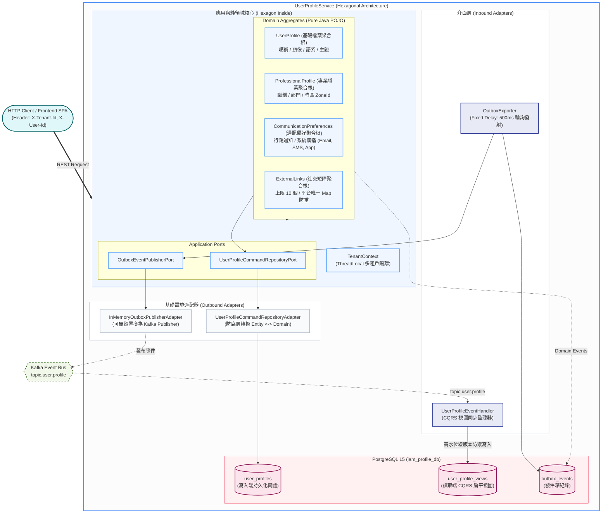

# UserProfileService (使用者個人檔案與個性化配置微服務)

> **定位**：自認證中心（AuthService）解耦之獨立微服務，專責管理跨租戶使用者的豐富畫像（Rich Profile）、個性化偏好（主題與語言）、專業職業屬性（時區與編制）、通訊隱私設定與外部社交鏈接。

---

## 目錄 (Table of Contents)
- [核心定位與職責](#核心定位與職責)
- [核心技術生態 (Tech Stack)](#核心技術生態-tech-stack)
- [系統架構藍圖 (Architecture Blueprint)](#系統架構藍圖-architecture-blueprint)
- [核心架構亮點與硬核設計](#核心架構亮點與硬核設計)
  - [1. 身分與畫像解耦原則 (Identity vs. Profile Decoupling)](#1-身分與畫像解耦原則-identity-vs-profile-decoupling)
  - [2. 四大領域聚合根與戰術 DDD 充血模型](#2-四大領域聚合根與戰術-ddd-充血模型)
  - [3. 嚴格六角架構 (Hexagonal / Clean Architecture)](#3-嚴格六角架構-hexagonal--clean-architecture)
  - [4. CQRS 讀寫分離與扁平視圖 (UserProfileView)](#4-cqrs-讀寫分離與扁平視圖-userprofileview)
  - [5. 發件箱模式 (Outbox Pattern) 與叢集安全](#5-發件箱模式-outbox-pattern-與叢集安全)
  - [6. GDPR / 現代隱私法規之通訊偏好預設](#6-gdpr--現代隱私法規之通訊偏好預設)
- [模組目錄結構 (Hexagonal View)](#模組目錄結構-hexagonal-view)
- [領域模型與值物件規格](#領域模型與值物件規格)
- [環境準備與啟動指南 (Getting Started)](#環境準備與啟動指南-getting-started)

---

## 核心定位與職責

在現代大型企業 IAM 系統中，若將使用者的「身分安全（Credentials & RBAC）」與「個人個性化資料（Avatars, Bios, Preferences, Links）」耦合在同一張資料表或同一個微服務中，會引發**安全風險泛化**與**寫入熱點鎖定**。

`UserProfileService` 專職實現身分與畫像的物理分離：

1. **共享身分標識 (1:1 Shared Identity Mapping)**：以 `userId` 作為物理主鍵，與 `AuthService` 的認證主體保持 1:1 的強關聯，無冗餘身分校驗。
2. **多維度個性化領域管控 (Multi-Dimensional Profiling)**：
   * **基本檔案 (Basic Profile)**：暱稱、頭像 URL、自我介紹（Bio）、國際化語系（Language）與系統深淺色主題（Theme）。
   * **專業職業檔案 (Professional Profile)**：職稱、部門關聯 ID、員工編號、跨國排程之時區資訊（`ZoneId`）。
   * **通訊與通知偏好 (Communication Preferences)**：行銷通知與系統維護更新之多渠道（Email / In-App / SMS）細粒度開關。
   * **外部連結矩陣 (External Links)**：個人作品集與社交平台（LinkedIn、GitHub、X/Twitter 等）之防超額（上限 10 個）安全收納。
3. **CQRS 極速扁平快照視圖 (Fast Read Model)**：寫入端維護實體，讀取端由專屬非同步處理器將多維度配置投影至 `user_profile_views`，支援高頻 UI 首頁秒開。
4. **可靠事件派發 (Reliable Outbox Pattern)**：所有屬性變更均封裝為帶版本號的領域事件，於資料庫本機事務寫入發件箱，透過樂觀鎖排程確保 At-least-once 派發。

---

## 核心技術生態 (Tech Stack)

* **核心框架**：Java 21, Spring Boot 4.0.7
* **持久化技術**：Spring Data JPA, Hibernate, PostgreSQL 15 (`iam_profile_db`)
* **消息總線 (EDA)**：Apache Kafka 3.6 (KRaft 模式) & Spring Kafka
* **時間與時區處理**：Java `java.time.ZoneId` & Jackson JSR-310 (JavaTimeModule)
* **資料校驗**：Hibernate Validator (`spring-boot-starter-validation`)
* **架構風格**：Hexagonal Architecture (Ports and Adapters), Tactical DDD, CQRS, Outbox Pattern

---

## 系統架構藍圖 (Architecture Blueprint)



---

## 核心架構亮點與硬核設計

### 1. 身分與畫像解耦原則 (Identity vs. Profile Decoupling)
* **單一職責分離 (SRP)**：
  * `AuthService`：負責機密等級最高的密碼雜湊、多因素驗證 (MFA)、JWT 簽發與 RBAC 權限。
  * `UserProfileService`：負責非機密但頻繁異動的個性化配置與外部鏈接。
* **無縫身分錨定**：
  * 本服務之聚合根直接以 `userId` (純字串或 UUID) 作為物理主鍵，不另設內部 Sequence ID，達成跨服務間 1:1 的零成本導覽。

### 2. 四大領域聚合根與戰術 DDD 充血模型
微服務內部依業務關注點垂直拆分為四大充血聚合根，徹底杜絕單一龐大實體（God Entity）：

1. **`UserProfile` 聚合根**：
   * 負責基礎檔案與外觀。
   * 封裝 `ProfileInfo`（顯示名稱、頭像、Bio）、`LanguagePreference`、`ThemePreference`。
   * 每次狀態變更自動推進 `version`，並註冊 `UserProfileUpdatedEvent`。
2. **`ProfessionalProfile` 聚合根**：
   * 負責企業員工職場屬性。
   * 封裝 `jobTitle`、`departmentId`、`employeeId`、以及原生 Java `ZoneId`（支援跨國時區排程）。
   * 業務方法：`updateJobAssignment(...)`、`updateTimeZone(...)`。
3. **`CommunicationPreferences` 聚合根**：
   * 負責精細化通訊偏好設定。
   * 封裝 `NotificationSetting`（Email、In-App、SMS 開關）。
   * 區分「行銷推播（Marketing）」與「系統廣播（System Updates）」。
4. **`ExternalLinks` 聚合根**：
   * 負責外部社交平台鏈接管理。
   * **領域不變量防護**：以 `Map<SocialPlatform, SocialLink>` 存儲，保證同一平台（如 GitHub）僅能存在一筆有效 URL；並嚴格限制全量鏈接上限為 10 筆（`MAX_LINKS_ALLOWED = 10`），防止惡意濫用。

### 3. 嚴格六角架構 (Hexagonal / Clean Architecture)
* **領域層純粹 POJO**：
  * `application/domain` 內部的四大聚合根與值物件絕無任何 JPA 標註，杜絕關聯式技術污染。
* **防腐層雙向映射 (Adapter Mapping)**：
  * `UserProfileCommandRepositoryAdapter` 透過 `UserProfileEntity.fromDomain()` 與 `toDomain()` 實現記憶體領域模型與資料庫持久化對象的安全轉換。

### 4. CQRS 讀寫分離與扁平視圖 (UserProfileView)
* **寫入端實體 (`UserProfileEntity`)**：
  * 配合 `@Version` 樂觀鎖維護資料一致性。
* **讀取端扁平視圖 (`UserProfileView`)**：
  * 將使用者所有頻繁讀取的個人資訊打平成去正規化欄位，專為前端 UI 首頁與個人中心讀取優化。
* **高水位線版本防禦 (High-Water Mark Defense)**：
  * 視圖端透過 `UserProfileEventHandler` 消費 `topic.user.profile` 事件時，實體內建版本檢查機制：若事件版本小於等於目前庫存版本，判定為亂序到達或 Kafka 重複消費，直接忽略不存檔。

### 5. 發件箱模式 (Outbox Pattern) 與叢集安全
* **本機事務一致性**：
  * 聚合根狀態變更時，產生的領域事件（如 `UserProfileUpdatedEvent`）於同一個 DB 交易中寫入 `outbox_events` 表。
* **定時輪詢發射器 (`OutboxExporter`)**：
  * 每 500 毫秒輪詢最早的 20 筆 `PENDING` 紀錄。
  * 利用 `OutboxEventDbEntity` 的 `@Version` 樂觀鎖機制，確保多節點部署時若有其他 Pod 搶先發送，本節點會捕獲 `ObjectOptimisticLockingFailureException` 並優雅跳過，消滅併發重複發送。

### 6. GDPR / 現代隱私法規之通訊偏好預設
* **Privacy by Default (預設隱私保護)**：
  * 在呼叫 `CommunicationPreferences.createDefault(userId)` 時，系統**預設將行銷通知全數關閉 (`allDisabled`)**，僅開啟必要的系統維護更新（`allEnabled`），完全符合歐盟 GDPR 與現代隱私權法令之嚴格合規底線。

---

## 模組目錄結構 (Hexagonal View)

```text
userprofile-service/src/main/java/com/example/demo/
├── UserprofileServiceApplication.java       # 微服務主啟動入口
│
├── application/                             # 【核心內部】Application & Domain Core
│   ├── domain/                              # 1. 純粹領域層 (Pure Java POJO)
│   │   ├── user/                            # UserProfile 聚合根、VOs、Events
│   │   │   ├── aggregate/                   # UserProfile.java, ProfileInfo, ThemePreference...
│   │   │   └── event/                       # UserProfileUpdatedEvent.java
│   │   ├── pro/                             # ProfessionalProfile 聚合根、ZoneId 封裝
│   │   ├── comunication/                    # CommunicationPreferences 聚合根、隱私設定
│   │   ├── ext/                             # ExternalLinks 聚合根、社交矩陣防護
│   │   └── shared/                          # Base DomainEvent, SocialLink, NotificationSetting
│   ├── port/                                # 2. 驅動埠與被動埠 (Inbound / Outbound Ports)
│   │   ├── UserProfileCommandRepositoryPort.java # 寫入持久化契約
│   │   └── OutboxEventPublisherPort.java         # 發件箱發射契約
│   └── shared/                              # Commands, Exceptions, Envelopes
│
├── iface/                                   # 【外圈輸入】Inbound Adapters
│   ├── event/
│   │   └── UserProfileEventHandler.java     # Kafka 事件視圖投影監聽器 (CQRS Read-Sync)
│   └── schedule/
│       └── OutboxExporter.java              # 500ms 高頻輪詢發件箱發射器
│
└── infra/                                   # 【外圈輸出】Outbound Adapters & Persistence
    ├── adapter/
    │   ├── UserProfileCommandRepositoryAdapter.java # JPA Repository 適配器
    │   └── InMemoryOutboxPublisherAdapter.java      # 發件箱廣播適配器
    ├── context/
    │   └── TenantContext.java               # ThreadLocal 多租戶上下文容器
    ├── persistence/                         # JPA 寫入端實體 (UserProfileEntity)
    ├── projection/                          # CQRS 讀取端扁平視圖 (UserProfileView)
    └── outbox/                              # OutboxEventDbEntity & Repository
```

---

## 領域模型與值物件規格

### 1. 語言與主題值物件 (Language & Theme Preferences)
* **`LanguagePreference`**：
  * `EN_US`（英文 - 美國）
  * `ZH_TW`（繁體中文 - 台灣）
  * `ZH_CN`（簡體中文）
  * `JA_JP`（日文）
* **`ThemePreference`**：
  * `LIGHT`（明亮主題）
  * `DARK`（深色主題）
  * `SYSTEM_DEFAULT`（跟隨作業系統設定）

### 2. 社交平台枚舉 (SocialPlatform)
* `LINKEDIN`、`GITHUB`、`TWITTER`、`FACEBOOK`、`INSTAGRAM`、`MEDIUM`、`PERSONAL_WEBSITE`、`YOUTUBE`。
* 每個平台在聚合根內部受 `Map` 鍵值約束，保證單一平台不重複。

### 3. 通知渠道設定 (NotificationSetting)
* 包含三維布林值：`email`（電子郵件）、`inApp`（站內通知）、`sms`（簡訊）。
* 提供語意工廠：`allEnabled()`、`allDisabled()`。

---

## 環境準備與啟動指南 (Getting Started)

### 1. 前置依賴建置
確認本地已安裝基礎共用安全模組 `shared-kernel`：
```bash
cd ../shared-kernel
mvn clean install
```

### 2. 基礎設施確認 (Docker)
確認本機環境之 PostgreSQL 資料庫已就緒：
* **PostgreSQL 15**：監聽 `localhost:5432`，資料庫預設為 `iam_profile_db`。
* **Kafka 3.6**：監聽 `localhost:9092`。

### 3. 設定檔說明 (`application.properties`)
```properties
spring.application.name=userprofile-service
server.port=8084

# PostgreSQL 連線設定
spring.datasource.url=jdbc:postgresql://localhost:5432/iam_profile_db
spring.datasource.username=postgres
spring.datasource.password=postgres
spring.jpa.hibernate.ddl-auto=create
```

### 4. 編譯與啟動微服務
在 `userprofile-service` 目錄下執行：

```bash
# 透過 Maven Wrapper 啟動 (Linux / macOS)
./mvnw spring-boot:run

# 於 Windows PowerShell 啟動
.\mvnw.cmd spring-boot:run
```

服務啟動後，將由 API 網關（Port `9000`）進行路由轉發與統一鑑權。
